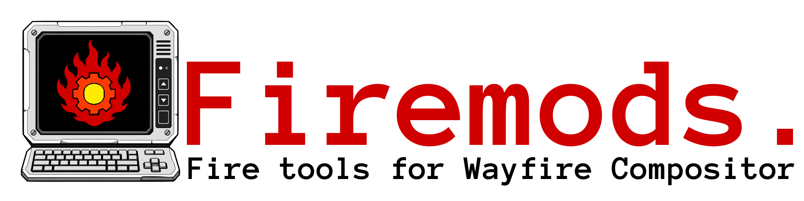

# Firemod 1.1

Firemod is a handcrafted utility suite for **Wayfire on Arch Linux**, combining persistent telemetry, application/output/region capture, and unified suite settings through three focused projects: **SUBSTR8 HUD**, **FrameTap**, and **Firemod**.

## License

Firemod 1.1 is source-available software distributed under the **Firemod Capture Immunity License, Version 0.2**. Inspection, local execution, modification, community redistribution, and independent interoperability are permitted under the license. Proprietary capture, paid rehosting, closed redistribution, and unauthorized commercial packaging are prohibited.

## Build and installation

All supported repository operations route through the root dispatcher:

```bash
./run.sh help
./run.sh build
./run.sh install
./run.sh legal-check
```

The installer preserves existing user configuration. Active SUBSTR8 HUD configuration lives under `${XDG_CONFIG_HOME:-$HOME/.config}/substr8-hud/`.

## Documentation

The public documentation opens on the project overview and includes a second tab for the complete searchable reference guide:

**[Read the Firemod documentation](https://substr8games.github.io/Firemod/)**



Project steward and licensing authority: **Giz@SUBSTR8Games**
